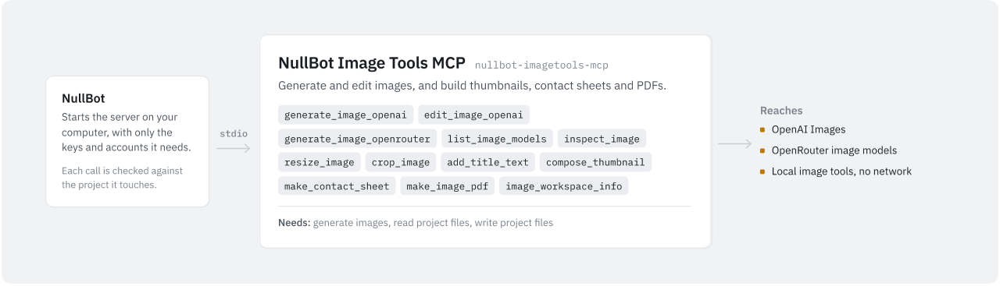

# NullBot Image Tools MCP

<picture>
  <source media="(prefers-color-scheme: dark)" srcset="assets/nullbot-imagetools-mcp-dark.svg">
  
</picture>


`nullbot-imagetools-mcp` generates and edits images with OpenAI and OpenRouter, and does local image work in Go: inspect, resize, crop, title text, thumbnails, contact sheets, and image PDFs. It reads and writes files only through paths relative to one workspace folder. It is a standalone Go MCP server built on [`github.com/Bradthebrad/tinychain/mcp`](https://github.com/Bradthebrad/tinychain). It works with NullBot and with any MCP client, and uses stdio by default.

## Tools

All paths are relative to the workspace folder.

Provider tools:

| Tool | What it does |
| --- | --- |
| `list_image_models` | Lists the known OpenAI image models (`gpt-image-2`, `gpt-image-1`, `dall-e-3`, `dall-e-2`) and asks OpenRouter for models that output images. `provider` limits the list to `openai` or `openrouter`. |
| `generate_image_openai` | Generates one image with the OpenAI Images API and saves it to `output_path`. `model` defaults to `gpt-image-1` and `size` to `1024x1024`; `quality` is optional. |
| `edit_image_openai` | Sends a workspace image, an edit `prompt`, and an optional `mask_path` to the OpenAI image edits endpoint and saves the result. `model` defaults to `gpt-image-1`; `size` is optional. |
| `generate_image_openrouter` | Generates an image with an OpenRouter model that outputs images and saves the first image in the reply. `model` is required. `site_url` and `app_name` set the `HTTP-Referer` and `X-Title` headers. |

Local tools:

| Tool | What it does |
| --- | --- |
| `image_workspace_info` | Shows the workspace, the path rule, `max_image_bytes`, whether OpenAI and OpenRouter keys are set, and the tool lists. |
| `inspect_image` | Returns format, MIME type, width, height, and file size. |
| `resize_image` | Resizes to `width` and `height` with `contain` (default; fits inside and pads with a dark background), `cover` (fills and crops the center), or `stretch`. |
| `crop_image` | Crops the rectangle given by `x`, `y`, `width`, and `height`. Values are clamped to the image. |
| `add_title_text` | Draws an uppercase `title` and optional `subtitle` on a semi-transparent band at the `top`, `center`, or `bottom` (default). `text_color` and `background_color` are hex, white on black by default. |
| `compose_thumbnail` | Builds a canvas (1280x720 by default) from an optional background image and a title band at the bottom. `background_fit` is `contain`, `cover`, or `stretch`; when it is omitted, the background is fitted with `contain`. `include_safe_area` draws a title-safe guide. |
| `make_contact_sheet` | Lays out images in a grid with optional file-name captions. `columns` defaults to 3 (1 to 12); thumbnails default to 320x220. |
| `make_image_pdf` | Builds a PDF with one image per page, scaled to fit. `page_size` is `letter` (default), `a4`, or another standard size (`a1` to `a6`, `legal`, `tabloid`); `orientation` is `portrait` (default) or `landscape`. `title` sets the PDF's title metadata; `captions` adds file names. |

Local tools read PNG, JPEG, GIF, and WebP. They write JPEG (quality 92) when `output_path` ends in `.jpg` or `.jpeg`, GIF for `.gif`, and PNG for anything else. Provider tools save the image bytes the provider returns, whatever the extension of `output_path`.

### Example calls

Generate an OpenAI image:

```json
{
  "prompt": "retro terminal robot mascot, bold gold pixels, black background",
  "output_path": "generated/nullbot-mascot.png",
  "model": "gpt-image-1",
  "size": "1024x1024"
}
```

Create a YouTube-style thumbnail with `compose_thumbnail`:

```json
{
  "background_path": "generated/nullbot-mascot.png",
  "output_path": "thumbs/demo-thumbnail.png",
  "title": "NO MAGIC HERE",
  "subtitle": "Just a client with tools",
  "width": 1280,
  "height": 720,
  "background_fit": "cover",
  "title_band_color": "#000000",
  "title_text_color": "#ffffff"
}
```

Build a contact sheet:

```json
{
  "image_paths": [
    "generated/a.png",
    "generated/b.png",
    "generated/c.png"
  ],
  "output_path": "sheets/contact.png",
  "columns": 3,
  "captions": true
}
```

Create a PDF:

```json
{
  "image_paths": [
    "pages/page-01.png",
    "pages/page-02.png"
  ],
  "output_path": "pdfs/coloring-book.pdf",
  "title": "Tiny Robot Coloring Book",
  "page_size": "letter",
  "captions": false
}
```

## Use it with NullBot

NullBot is a small, auditable Go agent ([Bradthebrad/nullbot](https://github.com/Bradthebrad/nullbot)) with a terminal UI and a headless CLI. Its main interface is the desktop app ([Bradthebrad/nullbot_ui](https://github.com/Bradthebrad/nullbot_ui)).

1. In the desktop app, open **Tools > Marketplace** and choose **Install** on NullBot Image Tools MCP. **Check for updates** refreshes the catalog from GitHub releases. The Marketplace installs the latest release, currently `v0.1.1`.
2. NullBot installs the server to `~/.nullbot/mcp/nullbot-imagetools-mcp` and, when the release has a `SHA256SUMS.txt`, verifies the binary against it.
3. NullBot starts the server over stdio with `--workspace` set to the folder of your primary project.
4. For the provider tools, add an OpenAI or OpenRouter API key in **Settings > Accounts**. NullBot passes it to the server as `OPENAI_API_KEY` or `OPENROUTER_API_KEY`, so you do not need to set environment variables yourself.

NullBot checks every tool call against the permission of the project it touches: Read only, Read & write, Full, or Custom. Full is needed to run programs. Where projects overlap, the stricter one wins. A call that names no folder is judged by the primary project.

NullBot works out what each tool needs (read, write, delete, or run) from the server's hints and the tool's name. You can change it per tool on the Tools page. This server sends no hints, so the names decide. With NullBot's current rules, `image_workspace_info`, `list_image_models`, and `inspect_image` need read, and every other tool needs write.

To build a server like this one, see the [mcp-skill](https://github.com/Bradthebrad/nullbot-skills/tree/main/skills/mcp-skill) package in Bradthebrad/nullbot-skills.

## Use it with another MCP client

Point the client at the binary and pass `--workspace`. The config format varies by client; a common shape is:

```json
{
  "mcpServers": {
    "imagetools": {
      "command": "C:\\path\\to\\nullbot-imagetools-mcp.exe",
      "args": ["--workspace", "C:\\path\\to\\images"],
      "env": {
        "OPENAI_API_KEY": "YOUR_OPENAI_API_KEY",
        "OPENROUTER_API_KEY": "YOUR_OPENROUTER_API_KEY"
      }
    }
  }
}
```

The `env` block is only needed for the provider tools. Without `--workspace`, the server uses the folder it was started in.

## Configuration

### Flags

| Flag | Default | Meaning |
| --- | --- | --- |
| `--transport` | `stdio` | `stdio`, `streamable-http`, `http`, or `sse`. |
| `--addr` | `127.0.0.1:8775` | Listen address for the HTTP and SSE transports. |
| `--path` | `/mcp` | Streamable HTTP endpoint. |
| `--sse-path` | `/sse` | Legacy SSE endpoint. |
| `--message-path` | `/message` | Legacy SSE message endpoint. |
| `--workspace` | `.` | Workspace folder. Image tools cannot leave it. |
| `--max-image-bytes` | `31457280` | Largest image file, in bytes, that the server decodes. |
| `--openai-api-key` | empty | OpenAI key. When set, it replaces `OPENAI_API_KEY` for this process. |
| `--openrouter-api-key` | empty | OpenRouter key. When set, it replaces `OPENROUTER_API_KEY` for this process. |
| `--version` | `false` | Print the version and exit. |

Keys can be passed as flags, as below, but flags are visible in process listings, so environment variables are the safer choice.

```powershell
.\nullbot-imagetools-mcp.exe --workspace "C:\path\to\images" --openai-api-key "YOUR_OPENAI_API_KEY" --openrouter-api-key "YOUR_OPENROUTER_API_KEY"
```

### Environment variables

| Variable | Used for |
| --- | --- |
| `OPENAI_API_KEY` | `generate_image_openai` and `edit_image_openai`. |
| `OPENROUTER_API_KEY` | `generate_image_openrouter`, and sent with the OpenRouter model list request in `list_image_models` when set. |

OpenAI image model access depends on the account. The tools default to `gpt-image-1` and accept `gpt-image-2`, `dall-e-3`, and other compatible models when the account has them. OpenRouter image output depends on the model: use `list_image_models` to find models that output images, then pass the model id to `generate_image_openrouter`.

### Transports

Default stdio:

```powershell
.\dist\nullbot-imagetools-mcp.exe --workspace "C:\Users\you\Pictures"
```

Streamable HTTP (`http` is the same transport):

```powershell
.\dist\nullbot-imagetools-mcp.exe --transport http --addr 127.0.0.1:8775 --path /mcp --workspace "C:\path\to\images"
```

Legacy SSE:

```powershell
.\dist\nullbot-imagetools-mcp.exe --transport sse --addr 127.0.0.1:8775 --sse-path /sse --message-path /message --workspace "C:\path\to\images"
```

## Safety

- Every path must be relative to the workspace. Absolute paths are rejected, and so are paths that leave the workspace with `..`. The client chooses the workspace before it starts the server, for example `--workspace "C:\Users\you\.nullbot\artifacts\images"`.
- Paths are checked after cleaning, but symlinks are not resolved. A symlink inside the workspace that points outside it is followed for both reads and writes, so do not keep such links in a workspace you give to an agent.
- Missing parent folders of `output_path` are created. An existing file at `output_path` is replaced without asking.
- `edit_image_openai` drops a `mask_path` that fails the path check and runs the edit without a mask.
- Provider tools send prompts to OpenAI or OpenRouter, and `edit_image_openai` uploads the input image and mask. When a provider replies with an image URL, the server downloads it. Image requests time out after 180 seconds.
- `--max-image-bytes` applies to images the server decodes. Images uploaded by `edit_image_openai` are not checked against it.
- `image_workspace_info` reports only whether keys are set, never their values.
- The HTTP and SSE transports have no authentication. Keep `--addr` on `127.0.0.1`.

## Build and test

The module needs Go 1.26.4 (from `go.mod`) and depends on tagged modules, including `github.com/Bradthebrad/tinychain` v0.2.0, `github.com/jung-kurt/gofpdf`, and `golang.org/x/image`. From a fresh clone:

```powershell
go mod download
go test ./...
go vet ./...
go build -trimpath -ldflags "-s -w" -o dist/nullbot-imagetools-mcp.exe ./cmd/nullbot-imagetools-mcp
```

On Linux or macOS, drop the `.exe` from the output name. `nullbot-imagetools-mcp --version` prints the version.

On 2026-10-27, `go vet ./...` and `go test ./...` passed with Go 1.26.4 on Linux.

## Limitations

- Only OpenAI and OpenRouter are supported. There are no adapters for FAL, Replicate, Stability, Leonardo, Ideogram, or a local ComfyUI.
- Text is drawn with one small built-in bitmap font, scaled up. Fonts cannot be chosen.
- Each call produces one image. `edit_image_openai` takes one input image and an optional mask; there are no multi-image edit helpers.
- There are no page templates for workbooks, coloring books, cards, or social batches. `make_image_pdf` places one image per page.
- `make_image_pdf` accepts PNG, JPEG, and GIF pages, chosen by file extension. WebP images fail.
- There are no OCR or image review tools. For reading text in images, use `vision_extract` in [nullbot-parsers-mcp](https://github.com/Bradthebrad/nullbot-parsers-mcp).
